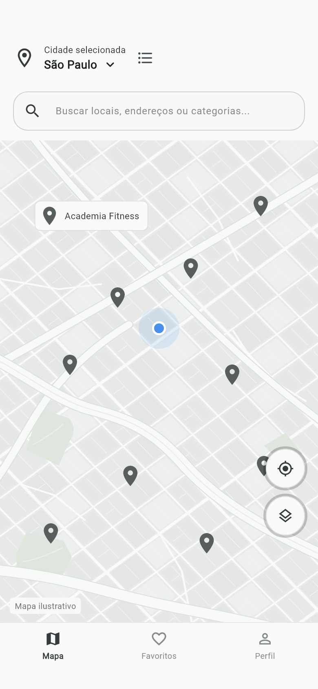
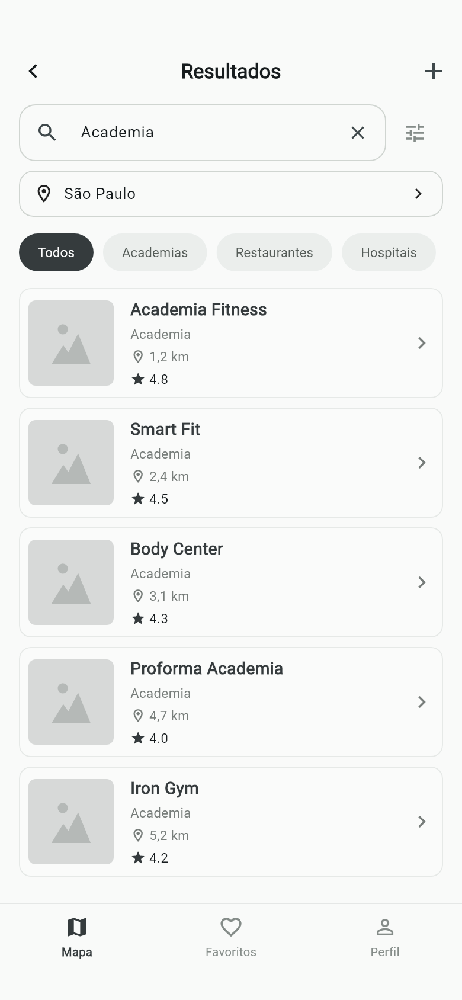
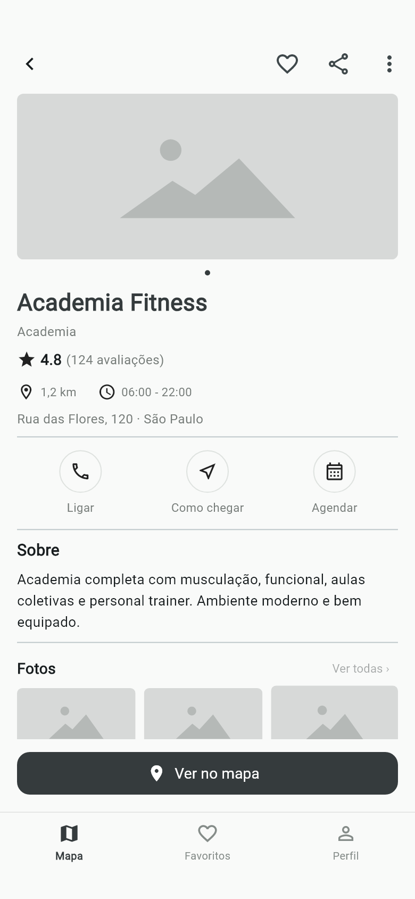
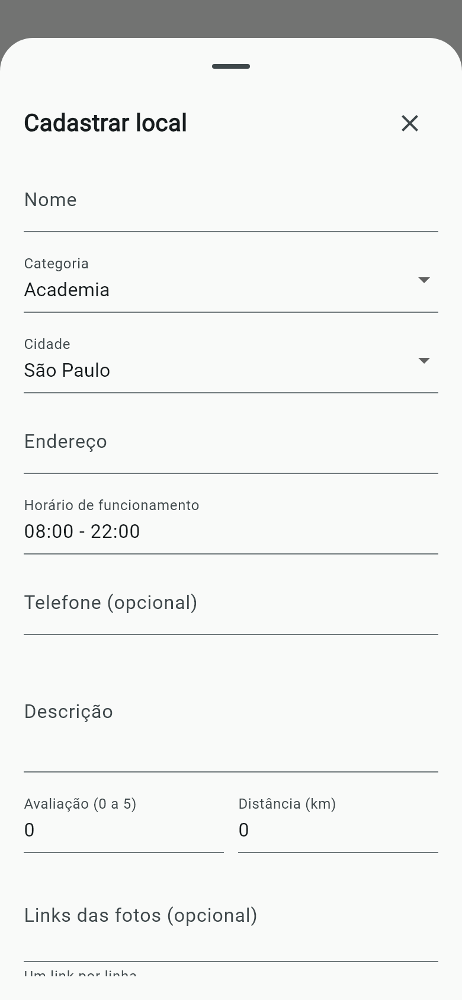
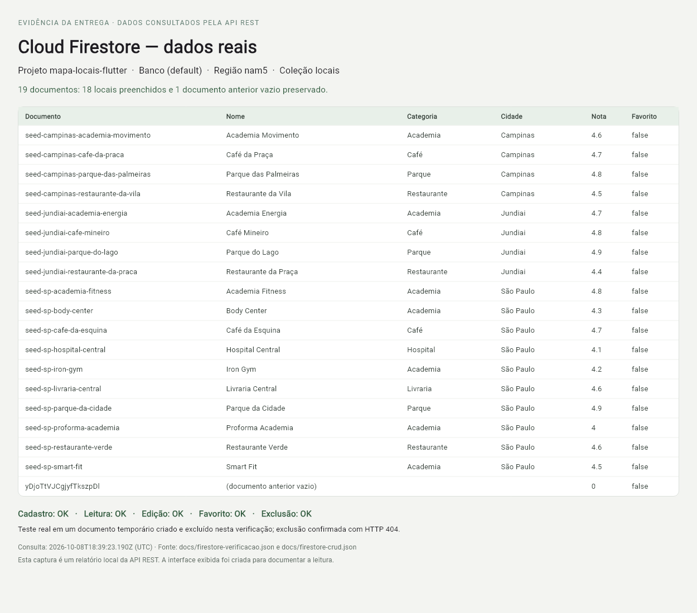

# Prints da entrega

As capturas nativas mostram o aplicativo Android usando o Firestore real. As capturas de teste usam os mesmos 18 locais em uma fixture explícita. O relatório do Firestore usa a consulta real anexada em `docs/firestore-verificacao.json`.

| Tela no Android | Imagem |
| --- | --- |
| Mapa | [android/01-mapa.png](android/01-mapa.png) |
| Resultados | [android/02-resultados.png](android/02-resultados.png) |
| Detalhes | [android/03-detalhes.png](android/03-detalhes.png) |
| Cadastro | [android/04-cadastro.png](android/04-cadastro.png) |

As observações da execução estão em [android-validacao.md](../android-validacao.md).

## Capturas de teste

| Tela | Imagem |
| --- | --- |
| Mapa | [01-mapa.png](01-mapa.png) |
| Resultados | [02-resultados.png](02-resultados.png) |
| Detalhes | [03-detalhes.png](03-detalhes.png) |
| Cadastro | [04-cadastro.png](04-cadastro.png) |
| Dados reais do Firestore, relatório REST | [05-firestore.png](05-firestore.png) |

## Mapa

## Resultados

## Detalhes

## Cadastro

## Firestore

Esta imagem apresenta os documentos consultados pela API REST; sua origem está indicada no próprio relatório.

